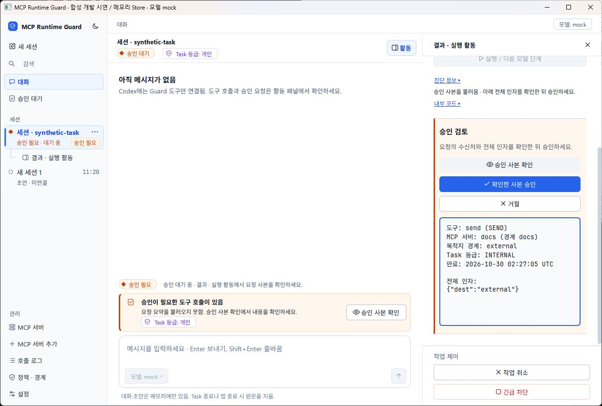
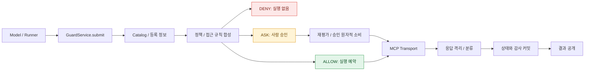

<h1 align="center">MCP Runtime Guard</h1>

<p align="center">
  <b>MCP 에이전트가 읽은 자료의 기밀성 등급을 작업 단위로 누적하고,<br>
  다음 도구 호출을 <code>ALLOW</code> · <code>ASK</code> · <code>DENY</code>로 판정하는 런타임 보안 게이트</b>
</p>

<p align="center">
  <a href="https://github.com/hsminu/MCP-Runtime-Guard/actions/workflows/ci.yml"></a>
  
  
  
  
  <a href="https://docs.astral.sh/uv/"></a>
  <a href="https://docs.astral.sh/ruff/"></a>
  <a href="https://mypy-lang.org/"></a>
</p>

<p align="center">
  <a href="#주요-기능">주요 기능</a> ·
  <a href="#호출-흐름">호출 흐름</a> ·
  <a href="#기본-정책">기본 정책</a> ·
  <a href="#설치와-실행">설치와 실행</a> ·
  <a href="#보안-불변식">보안 불변식</a> ·
  <a href="#문서">문서</a>
</p>

<p align="center">
  
</p>

<p align="center">
  <sub>합성 시연(<code>--demo</code>)의 승인 검토 화면. INTERNAL 자료를 읽은 뒤의 SEND가 ASK로 멈추고, 사람이 요청 사본을 확인한 뒤 승인한다.</sub>
</p>

MCP 에이전트가 읽은 자료의 기밀성 등급을 작업 단위로 누적하고, 다음 도구 호출의 **MCP 서버 경계와 최종 목적지 경계**를 검사하는 런타임 보안 게이트다. 각 호출을 `ALLOW`, `ASK`, `DENY`로 판정하고, 사람 승인과 실제 전송을 연결한다.

## 주요 기능

- **누적 등급 추적**: 작업이 읽은 자료의 등급을 누적하고, 그 등급을 다음 도구 호출의 판정에 적용한다.
- **두 경계 검사**: 모든 호출은 MCP 서버 경계를, `SEND`는 최종 목적지 경계도 검사한다. 가장 엄격한 판정이 최종 판정이다.
- **승인과 전송의 연결**: `ASK`는 사람이 확인한 요청 사본과 해시가 일치하고 재평가를 통과했을 때, 승인 1건당 최대 1회 실행한다.
- **응답 격리**: 도구 결과는 격리·분류하고 보안 상태를 커밋한 뒤에만 모델·UI·로그로 공개한다.
- **fail-closed**: 판단 불가와 예외는 `DENY` 또는 작업 정지로 처리하고, 결과가 불명인 쓰기는 자동 재전송하지 않는다.
- **서버 등록과 검사**: stdio·HTTP MCP 서버를 등록하면 Cisco Scanner 검사 결과를 경고로 보여주고, 사용자가 활성화한 서버만 실행한다.
- **Codex 하네스**: 모델은 고정 버전 Codex(`codex.exe` 0.162.1)로 실행하며, 모델이 쓸 수 있는 도구는 Guard 도구뿐이다.
- **데스크톱 앱**: 실행·승인·서버 검사 화면을 제공하는 PySide6 앱이다.

## 해결할 문제

공개 문서를 읽고 공개 이슈를 작성하는 호출과, 개인 메모를 읽은 뒤 같은 이슈를 작성하는 호출은 도구와 인자가 비슷해도 위험이 다르다. Guard는 작업의 누적 등급을 다음 호출에 적용한다. 최종 목적지가 사용자 본인의 저장소여도 중간의 외부 MCP 서버가 인자를 받는다면 서버 경계에서 검사한다.

- 자료 등급: `PUBLIC < INTERNAL < CONFIDENTIAL`.
- 기본 추적 방식: Task별 high-watermark를 유지하는 `accumulate`.
- `Unclassified`는 별도 플래그다. 출처를 확정하지 못하면 작업을 정지하며, 기존 작업에서 해제하지 않는다.
- `stdio`·Streamable HTTP는 접속 방식이다. 내부·외부 신뢰는 사용자가 등록한 정보로 결정한다.
- 접근 규칙은 거부권만 가진다. 접근 규칙 허용이 Guard의 `ASK`·`DENY`를 완화하거나 사람 승인을 대체하지 않는다.

## 호출 흐름



관리 대상 도구 실행의 유일한 입구는 `GuardService.submit()`이다. 승인 후 실행도 같은 Guard의 재평가·예약·dispatch 경로를 따른다. 결과는 **수신 → 격리 → 분류 → 상태 커밋 → 공개** 순서로 처리한다.

## 기본 정책

먼저 `effective_label > boundary.max_label`이면 `DENY`다. 이를 통과한 경계에는 아래 기본 행렬을 적용한다.

| 작업의 유효 등급 | internal | approved_external | general_external |
| --- | :---: | :---: | :---: |
| PUBLIC | ALLOW | ALLOW | ALLOW |
| INTERNAL | ALLOW | ASK | ASK |
| CONFIDENTIAL | ALLOW | DENY | DENY |

모든 호출은 서버 경계를 검사하고, `SEND`는 목적지 경계도 검사한다. 서버·목적지·접근 규칙 결과 중 가장 엄격한 판정이 최종 판정이다. 외부 경계의 `max_label`은 `INTERNAL` 이하만 허용하므로 기밀 자료의 외부 전송은 승인으로 우회할 수 없다. CONFIDENTIAL 자료를 사용자 본인의 대상으로 보낼 때도 그 대상이 받을 수 있게 등록되어 있어야 한다.

`ASK`는 요청 사본의 해시가 일치하고, 현재 상태로 재평가를 통과하며, 승인 1건을 원자적으로 소비했을 때 최대 1회 실행한다. 쓰기 호출의 결과가 불명이면 `UNKNOWN_OUTCOME`으로 작업을 잠그고 자동 재전송하지 않는다.

## 설치와 실행

Python 3.12와 [uv](https://docs.astral.sh/uv/)를 사용한다. uv가 `.python-version`의 3.12를 설치한다.

```powershell
git clone https://github.com/hsminu/MCP-Runtime-Guard.git
cd MCP-Runtime-Guard

# 설치
uv sync --locked
uv run python tools/install_codex.py

# 제품 실행 (Windows)
uv run python -m guard_app

# 합성 시연
uv run python -m guard_app --demo
uv run python -m guard_app --demo --mcp-transport http
uv run python -m guard_app --demo --scenario deny
uv run python -m guard_app --demo --store sqlite --db-path <파일>

# 검증·테스트
uv run python -m examples.verify_stdio_spike
uv run python -m examples.verify_http_spike
uv run pytest -q
```

저장소 루트에서 실행한다. `--demo` 없는 실행이 제품 실행이고 Windows에서만 동작한다.
제품 실행은 단일 실행 잠금을 잡고 앱 폴더(`%LOCALAPPDATA%\MCPRuntimeGuard`)의 고정 DB(`data\guard.sqlite3`)만 연다.
`tools/install_codex.py`가 고정 버전 `codex.exe`를 앱 폴더에 설치하며, 다른 위치의 같은 파일은 `--codex-exe <절대 경로>`로 지정한다.
시작할 때 이전 실행에서 끝나지 않은 Task를 정리하며, 이전 승인은 복원하지 않고 결과 불명 SEND를 재전송하지 않는다.

합성 시연(`--demo`)은 합성 자료·합성 서버·mock 모델로 처음부터 끝까지 실행한다.
`--scenario`·`--mcp-transport`·`--store`·`--db-path`는 시연 전용이라 `--demo`와 함께만 쓴다.

<details>
<summary><b>합성 시연 진행과 옵션</b></summary>

시연은 실행 탭에서 실행 → 승인 사본 확인 → 승인 → 다음 모델 단계를 누른다.
합성 INTERNAL 읽기 후 ASK, 승인 뒤 SEND 한 번이 기본 경로다.
`--scenario allow`는 PUBLIC, `--scenario deny`는 CONFIDENTIAL 읽기를 사용한다.
실제 외부 목적지로 보내지 않고 합성 서버 내부 계수만 올린다.

시연의 `--db-path`는 제품 앱 폴더 밖이어야 하고 부모 디렉터리는 미리 있어야 한다.

</details>

<details>
<summary><b>HTTP transport 범위</b></summary>

`--mcp-transport http`는 앱이 띄운 `127.0.0.1` 합성 서버와 실제 TCP로 통신한다.
기본값은 `stdio`다. HTTP는 JSON·SSE 응답을 지원하고 redirect·자동 인증·POST 재시도를
사용하지 않는다. 응답 유실·timeout 뒤 SEND는 결과 불명으로 처리한다.
CLI는 임의 외부 서버 URL·인증정보를 받지 않는다. 제품은 서버 등록 화면에서 URL을 받아
endpoint 검증을 거치고, HTTP 서버 인증은 지원하지 않는다.

</details>

<details>
<summary><b>접근 규칙</b></summary>

접근 규칙은 신뢰 설정의 서버·도구 정확 일치 허용/거부 목록을 사용한다. 기본은 거부이고 거부가 우선이다.
접근 허용은 사람 승인을 대체하거나 Guard의 ASK·DENY를 완화하지 않는다.
시연은 합성 도구를 모두 허용하는 고정 규칙을 쓴다.
거부 규칙(SEND만 거부, 전부 거부)의 전송·수신 계수는 `verify_stdio_spike`·`verify_http_spike`가 함께 확인한다.

</details>

## 보안 불변식

| ID | 반드시 지킬 조건 |
| --- | --- |
| I1 | 관리 대상 도구 실행은 Guard를 거친다. transport를 외부에 노출하지 않는다. |
| I2 | DENY는 승인 경로를 포함해 dispatch되지 않는다. |
| I3 | ASK는 일치하는 승인의 원자적 소비 후 최대 1회 실행한다. |
| I4 | 누적 등급은 내려가지 않고 Unclassified는 해제되지 않는다. |
| I5 | 결과는 보안 상태 커밋 후에만 모델·UI·로그로 공개한다. |
| I6 | 판단 불가와 예외는 DENY 또는 작업 정지로 처리한다. |
| I7 | 등급·경계·승인자·Task 식별자는 신뢰 설정과 실행 상태에서 도출한다. |
| I8 | 결과 불명의 쓰기는 자동 재전송하지 않는다. |
| I9 | 원문·인증정보·전체 인자를 기본 로그에 기록하지 않는다. |
| I10 | 도구 정의 변경 시 서버를 PENDING으로 돌리고 기존 승인을 무효화한다. |
| I11 | 모델이 쓸 수 있는 도구는 Guard 도구뿐이다. Codex 자체 도구가 꺼졌음을 확인하지 못하면 Task를 시작하지 않는다. |

`DISPATCHING` 예약 전의 예외는 `Denied`로 처리한다. 예약 후의 예상하지 못한 예외는 READ의 결과 미공개·Task 정지, SEND의 결과 불명으로 처리한다. 실제로 나갔을 수 있는 요청을 차단된 것으로 보고하지 않는다.

## 검증과 보호 범위

차단 여부는 화면 문구 대신 `approval_consumed`, `host_dispatch`, 실제 HTTP `tools/call` 수, `receiver_effect`로 확인한다. DENY·승인 전 ASK의 전송 계수는 0, 승인된 ASK의 소비·dispatch·수신 부작용은 각각 최대 1이어야 한다.

Guard는 기밀성 추적과 관리 대상 `tools/call` 경로를 보호한다. 모델 API로 보내는 프롬프트 자체, 원격 서버 수신 후 재전송, 호스트 OS·로컬 악성 프로세스, 사용자의 직접 민감정보 입력, `resources/read`·`prompts/get`, 무결성 추적은 설계 범위 밖이다.

## 구성

소스는 `src/guard_app/` 아래에 있다.

| 구성 | 책임 |
| --- | --- |
| `domain`, `ports` | 신뢰 출처가 분리된 불변 모델과 모듈 간 계약 |
| `core` | 외부 I/O 없는 정책 판정·등급 병합·결정표 |
| `services` | Guard·승인·응답 게이트, Runner·bridge, registry |
| `adapters` | MCP·접근 규칙 연결·모델, Cisco Scanner |
| `security` | 위험 연산, 예외 판정 변환·승인 해시 |
| `storage` | SQLite·스키마·복구·원자적 트랜잭션 |
| `ui` | 실행·승인·서버 검사 화면 |

`core`는 `domain`과 표준 라이브러리만 의존하고, UI는 bridge를 통해 명령·이벤트로 통신한다. 전체 구조는 [기술 설계](docs/technical-design.md) 2장에 있다.

## 개발

설계 기준은 Python 3.12, MCP Python SDK 1.x, Pydantic, PySide6, SQLite, pytest다. 의존성은 `pyproject.toml`·`uv.lock`에 고정했다.
환경은 `uv.lock` 하나로 관리하고 `requirements.lock`은 거기서 생성한다.

```powershell
uv run ruff check .
uv run ruff format --check .
uv run mypy
uv run lint-imports --config tools/ci/importlinter.ini
uv run bandit -r src -ll -q
uv run pytest -q
uv run pytest -q tests/contract
```

CI의 Windows 작업은 locked 설치 → `requirements.lock` 일치 → Ruff → 포맷 → mypy → import 계약 → Bandit → 단위 테스트 → contract 테스트 순서로 돌고, Semgrep은 Linux 작업에서 따로 돈다.
브랜치와 리뷰 규칙은 [협업 규칙](docs/team-workflow.md)을 따른다.

## 문서

| 문서 | 내용 |
| --- | --- |
| [기술 설계](docs/technical-design.md) | 상세 설계, 테스트 계획, ADR |
| [설계 결정과 계약](docs/contracts.md) | 확정한 결정, 모듈 간 계약 |
| [보안 점검 기록](docs/weakness_register.md) | 검사 실행 기록, 발견 항목과 조치, 규칙 예외 |
| [협업 규칙](docs/team-workflow.md) | 모듈 소유권, 리뷰, 브랜치 사용법 |
| 진행 현황 | [애플리케이션](docs/a-status.md) · [보안 코어·저장소](docs/b-status.md) · [보안 기반·검증](docs/c-status.md) |
| [에이전트 작업 지침](AGENTS.md) | AI 에이전트가 읽는 작업 규칙 |
| [작업 기록](docs/archive/) | 완료 기록, 이전 작업 기록·실험 근거 |
